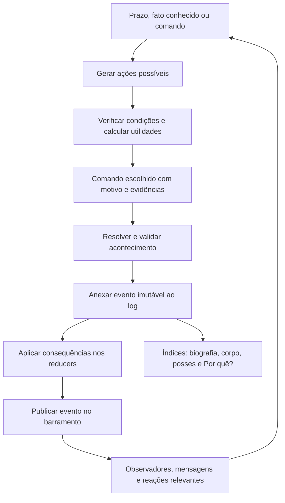

# Chronicle World — design da simulação orientada a agentes

**Marco:** 2b mínimo: parentesco, gestação, infância simulada, envelhecimento e linhagens sobre o corpo do 2.1 e as emoções do 1d.
**Estado:** implementação experimental; ver [relatório do Marco 2b](MARCO2B-REPORT.md) e [modelo e limites](MARCO2B-MODELO.md). UI/mapa permanecem v1. Proteção, amizade, personalidade e obra preservam os pesos aprovados.
**Pesquisa encerrada:** por instrução do usuário, não consultar a wiki. Todas as escolhas corporais são **suposição de design, não verificado**; [fontes e limites](MARCO2-FONTES.md). A consulta não é condição de aprovação. As seções históricas abaixo descrevem etapas anteriores e não reabrem essa condição.

## 1. Resultado pretendido e limites desta etapa

Histórias devem nascer da interação entre indivíduos com personalidade, valores, necessidades, corpo, conhecimento e objetivos. Uma guerra precisa de alguém interessado nela, condições que a tornem possível, uma decisão política e consequências verificáveis. Uma vingança exige uma ofensa conhecida, memória persistente, alvo identificável, oportunidade e capacidade. Um texto bonito não substitui essas regras.

O Marco 0 especifica contratos, fluxo, dados, exemplos de aceitação e critérios de verificação. **Nenhum exemplo neste documento foi produzido pelo motor novo:** são cenários ilustrativos para orientar sua implementação e futuros testes. O relatório automatizado de histórias só existirá a partir do Marco 1. Build e testes executados agora verificam o projeto existente; não demonstram que a arquitetura proposta funciona.

Dwarf Fortress é referência conceitual. Não se pretende reproduzir seus algoritmos proprietários nem atribuir ao jogo as fórmulas propostas abaixo. O sistema de utilidade, o event sourcing, os pesos, o calendário e os limites aqui descritos são decisões de design do Chronicle World.

### Situação da pesquisa — verificação após autorização explícita

O usuário autorizou expressamente a consulta à wiki. Foi feita nova tentativa de leitura de `https://dwarffortresswiki.org/index.php/World_generation`, com TLS e proxy preservados. O CONNECT voltou a receber `403 Forbidden`, antes de qualquer página ser recebida. Não houve negativa de revisão automática do comando: o comando foi permitido e quem recusou a conexão foi o proxy de rede.

Verificações desta revisão, em 3 de novembro de 2026:

- O rascunho de configuração, revisão 2, já inclui `dwarffortresswiki.org`; o preset `package_managers` permanece preservado.
- O estado atual relata política restrita **enforced** e observações atuais, mas a lista de domínios personalizados aplicada continua vazia.
- `/etc/codex/network-policy.json` também não inclui a wiki. A autorização no chat não altera essa política técnica.
- Não foi repetida uma gravação idêntica do rascunho, não foram removidos controles de rede e não se tentou contornar o proxy.

**Registro histórico, superado pela dispensa de pesquisa do Marco 2.** Nenhuma das páginas citadas abaixo foi lida nesta tarefa. As URLs indicam as fontes que devem fundamentar a adaptação, mas ainda não são citações de conteúdo verificado. Nenhuma nova tentativa ou publicação é necessária; a pesquisa foi dispensada pelo usuário.

O agente pode concluir o orçamento, o recorte e o resumo sem essa dependência. Não é possível declarar a pesquisa concluída apenas com a permissão textual ou preencher notas factuais sem ler as fontes.

## 2. Pesquisa: conceitos a verificar e adaptação proposta

Todos os links abaixo estão **pendentes de consulta**, incluindo a confirmação de títulos, seções e redirecionamentos. Após a leitura, acrescentar data de acesso, URL final, versão e uma nota factual curta em cada linha. Não copiar tabelas ou textos extensos da wiki.

| Tema / referência planejada | Pergunta para a leitura | Adaptação proposta no Chronicle World |
| --- | --- | --- |
| [World generation](https://dwarffortresswiki.org/index.php/World_generation) | Como geografia, entidades e história são apresentados como etapas? | Bootstrap geográfico separado da simulação histórica; parâmetros e versão gravados na origem. |
| [Historical figure](https://dwarffortresswiki.org/index.php/Historical_figure) | Quais ligações persistem entre figuras, entidades e acontecimentos? | IDs estáveis, vínculos temporais e biografia como projeção de fatos. |
| [Personality trait](https://dwarffortresswiki.org/index.php/Personality_trait) | Como facetas, valores, necessidades e sonhos se distinguem? | Vetores separados de traços, valores e objetivos; nenhum rótulo único decide toda a conduta. |
| [Emotion](https://dwarffortresswiki.org/index.php/Emotion) | Como eventos, emoções e lembranças se relacionam? | Avaliação individual do mesmo fato, memória com peso e fonte; transformação registrada. |
| [Stress](https://dwarffortresswiki.org/index.php/Stress) | Como necessidades e experiências afetam o estresse? | Acúmulo/recuperação, limiares com histerese e consequências dependentes de personalidade. |
| [Body part](https://dwarffortresswiki.org/index.php/Body_part) | Como a anatomia e a conexão entre partes são representadas? | Árvore anatômica por arquétipo e capacidades derivadas das partes funcionais. |
| [Tissue](https://dwarffortresswiki.org/index.php/Tissue) | Como materiais biológicos e camadas diferem? | Tecidos ordenados com resistência, perfusão e função; órgãos não viram camadas universais de todos os membros. |
| [Wound](https://dwarffortresswiki.org/index.php/Wound) | Como ferimentos persistentes afetam capacidades e sobrevivência? | Lesões identificáveis ligadas ao golpe, dor, sangramento, recuperação e sequelas. |
| [Combat](https://dwarffortresswiki.org/index.php/Combat) | Como equipamentos, habilidades, contato e dano se relacionam? | Duelo por ações discretas, geometria/material simplificados e relatório de cada golpe. |
| [Legends](https://dwarffortresswiki.org/index.php/Legends) | Que relações e acontecimentos podem ser explorados? | Projeções navegáveis e cadeia causal; narrador acessa fatos conhecidos, sem inventar motivos. |
| [Artifact](https://dwarffortresswiki.org/index.php/Artifact) | Que informações ligam objetos, criadores, representações e proprietários? | Criação motivada, conteúdo referenciando eventos reais e diário completo de custódia. |
| [Megabeast](https://dwarffortresswiki.org/index.php/Megabeast) | Como ameaças nomeadas participam da história? | Agentes com corpo, desejos, território, lembranças e regras de ação específicas. |
| [Necromancer](https://dwarffortresswiki.org/index.php/Necromancer) | Qual o papel de conhecimento, imortalidade e seguidores? | Aprendizado e busca de imortalidade com acesso a conhecimento e custos explícitos. |
| [Vampire](https://dwarffortresswiki.org/index.php/Vampire) | Como identidade, alimentação e ocultação podem influenciar a vida social? | Identidade pública e real separadas; suspeitas, evidências e decisões de investigação. |

Beliefs/values e goals/dreams terão suas seções localizadas durante a consulta de personalidade; não assumir que cada expressão é um título de página independente. Wounds, camadas e combate devem ser lidos em conjunto. A pesquisa deve informar as escolhas sem transformar peculiaridades do Dwarf Fortress em dependências obrigatórias desta simulação.

### O que a inspeção local confirmou

- `src/types/index.ts`: pessoa tem dois traços em texto, ambição em texto e relações rotuladas; não tem necessidades, memória ou corpo.
- `src/engine/history.ts`: muitas ações são selecionadas com probabilidades anuais; estado é alterado diretamente antes/depois de registrar o evento.
- O evento atual possui participantes sem papéis, ano sem dia, consequência em texto e `cause` opcional.
- `validate.ts` verifica várias referências e datas, mas a granularidade anual não impede alguém de agir depois da morte dentro do mesmo ano.
- O Worker, a separação básica do motor, o RNG e o Canvas existentes são pontos úteis para reaproveitar gradualmente; não tornam o motor atual orientado a agentes.

## 3. Princípios e decisões arquiteturais

1. **Motor puro:** TypeScript sem DOM, rede, relógio real, armazenamento ou módulos da UI. Entradas: parâmetros, seed e comandos. Saídas: fatos, projeções, métricas e diagnóstico.
2. **Acontecimento registrado é a autoridade:** reducers determinísticos materializam o estado a partir de eventos. Sistemas não alteram tabelas diretamente.
3. **Decisão não é resultado:** escolher atacar não garante acertar, ferir, matar ou ser observado. São fatos separados.
4. **Conhecimento é local:** um agente não descobre um assassinato distante porque o motor tem acesso ao evento. Testemunho, mensagem ou evidência precisa chegar até ele.
5. **Causalidade rastreável:** toda mudança persistente liga-se a fatos anteriores. Raízes são exclusivamente a origem do mundo; causas não são preenchidas artificialmente só para passar validação.
6. **RNG para variação e resolução:** candidatos a ação vêm de condições reais. Utilidade escolhe o comportamento; ruído pequeno desempata escolhas próximas. Não há roleta anual de tipos de evento.
7. **Reações têm alcance:** evento atualiza projeções; apenas assinantes pertinentes recebem reações. Não existe reação global automática de todos os agentes.
8. **Nenhuma história é garantida em toda seed:** testar condições e várias seeds; nunca criar uma vingança só para cumprir uma quota do relatório.

## 4. Tempo, identidade e contrato de dados

### Tempo e ordem

Calendário ficcional de **360 dias por ano**. `ano >= 0`, `dia` entre 0 e 359. Um `seq` global estritamente crescente fornece a ordem dentro do mesmo dia. Causas devem ter `seq` menor que o efeito e data não posterior. Assim, morte às ordens 120–121 impede ação na ordem 122 mesmo no mesmo dia. Combate usa rodadas ordenadas dentro desse dia; passos fisiológicos podem ocorrer entre rodadas.

O motor agenda somente os próximos prazos relevantes. Não precisa executar 360 atualizações completas por agente a cada ano. Necessidades e memórias podem ser calculadas na próxima consulta usando o instante da última alteração. O calendário e as regras de integração fazem parte da versão do motor.

IDs globais incluem tipo e sequência (`person:0004`, `body:0004`, `event:0018`). Não derivar identidade de nomes ou posições em arrays. Colisões ou referências de tipo errado são erros. Ordenar desempates por ID com comparação ASCII explícita, sem `localeCompare` dependente do ambiente.

### Envelope de um mundo futuro (schemaVersion 2)

| Campo | Conteúdo |
| --- | --- |
| `manifest` | ID do mundo, schemaVersion, engineVersion, dataVersion, seed, parâmetros, calendário, versão do algoritmo de RNG. |
| `events` | Log append-only ordenado. Cada evento inclui os resultados aleatórios já resolvidos necessários ao replay. |
| `checkpoint` | Opcional: projeções, último seq e hash correspondente. É cache conferível; não substitui o log. |
| `scheduler` | Prazos e comandos pendentes, ou dados suficientes para reconstruí-los deterministicamente. Não depende do relógio do computador. |
| `report` | Opcional: índices e métricas derivados, sempre reconstruíveis. |

Replay não decide ações nem consome RNG: aplica exatamente as consequências gravadas. Continuar a simulação precisa do estado do agendador e da versão dos dados. Em caso de versão incompatível, abrir o histórico em modo leitura ou pedir conversão suportada, sem reinterpretar silenciosamente eventos antigos.

### Registro imutável de acontecimento

O exemplo é um **contrato descritivo**, não código a implementar neste marco:

```text
Event = {
  id, kind: "event", schemaVersion, seq,
  ano, dia, tipo,
  participantes: [{ entidadeId, papel }],
  localId,
  causas: [eventId, ...],
  consequencias: [Effect, ...],
  dados: payload tipado pelo tipo do evento
}
```

- `causas` existe em todos os eventos. Somente `world.created` admite `[]`; seu payload guarda a origem/configuração da geração. Toda criação inicial referencia esse evento.
- O primeiro evento pode criar o lugar inicial e o mundo usados como contexto no próprio registro; essa exceção de bootstrap é validada explicitamente. Eventos posteriores só referenciam entidades já existentes ou criadas atomicamente naquele evento.
- Papéis têm semântica: `ator`, `alvo`, `vitima`, `testemunha`, `falecidoReferenciado`, `objeto`, `beneficiario`, `contexto`. Referenciar alguém morto em uma herança é válido; fazê-lo agir ou testemunhar depois da morte é inválido. O alvo de uma mutilação deve estar vivo; o alvo de um rito funerário pode estar morto. Cada tipo declara seus papéis e restrições.
- Consequências são operações tipadas, por exemplo `entity.created`, `resource.delta`, `relation.changed`, `goal.adopted`, `body.injured`, `custody.transferred`. Incluir alvo, valor anterior/novo quando necessário e unidade/faixa; não executar caminhos arbitrários de JSON nem strings como código.
- `dados` registra detalhes particulares: arma, parte atingida, motivo, termos da proposta, observadores, dados de resolução. Texto de narrativa é projeção desses campos, não fonte da verdade.
- Eventos já confirmados não são editados. Uma correção é um novo evento explícito; a UI pode mostrar a correção e o fato original.
- `readonly` fornece proteção de compilação; testes usam freeze profundo. O serializador não entrega referências mutáveis do armazenamento aos assinantes.

### Entidades e relações

| Entidade | Componentes principais / referências |
| --- | --- |
| Pessoa / criatura agente | Identidade, espécie/cultura, nascimento, morte-evento, corpoId, localId, personalidade, valores, necessidades, habilidades, objetivos, memórias, conhecimento, reputação. Criaturas usam o mesmo núcleo com capacidades e ações próprias. |
| Corpo | Proprietário, arquétipo, partes, tecidos, volumes, reservas fisiológicas, lesões e capacidades calculadas. |
| Objeto / obra | Material, massa, forma, estado, criador, local, custódia, propriedades materiais e significado; representações de figuras/eventos existentes. |
| Lugar | Tipo (inclusive vazio de teste), posição quando houver mapa, conexões, ocupação, estoque e instituições. |
| Civilização / facção | Membros e cargos por intervalos, regras de sucessão, recursos, políticas, valores coletivos, pactos e legitimidade. |
| Religião | Doutrinas, valores/tabus, divindades como entidades de crença, participantes, instituições, cismas e vínculos históricos. Não pressupõe que a divindade aja fisicamente. |
| Relação | Origem, destino, tipo, intensidade, confiança, atração/ressentimento, início/fim, fontes de cada alteração; relações sociais podem ser assimétricas. Parentesco é relação tipada com invariantes próprias. |
| Objetivo | Dono, tipo, alvo, prioridade, compromisso, critério de conclusão, estado e evento de adoção. |
| Memória | Dono, evento vivido ou relato recebido, sujeitos lembrados, emoção, intensidade inicial, persistência, último reforço e evidência disponível. |
| Lesão | Corpo/parte/tecidos, evento de origem, agressor e arma se conhecidos, severidade, sangramento, perda funcional, cicatrização e sequelas. |
| Evento | Identidade própria; participantes por papéis, local, causas, dados e consequências. |

Todos os registros relacionáveis (inclusive religião, corpo, memória, objetivo e ferimento) têm ID e criação no log. Referências entre eventos usam o mesmo registro global com checagem de tipo. Habilidade, traço e valor são componentes catalogados, não entidades novas para cada número.

Uma pessoa morta não é removida. Vínculos são encerrados por eventos, não apagados do passado. Filho não exige pais ainda vivos hoje: exige pais válidos no nascimento/concepção e cronologia consistente. No primeiro modelo, gestação é agendada e a concepção é um fato; morte posterior de um dos pais não invalida o nascimento. Filiação adotiva é separada da biológica. Fundadores têm uma origem anterior ao começo da história, registrada como inicialização, nunca como nascimento de adulto no presente.

## 5. Fonte de eventos, barramento e causalidade

### Fluxo de uma ação



Somente o dispatcher confirma eventos. O comando propõe uma intenção e suas evidências; um resolver consulta o estado atual, verifica as condições e produz consequências concretas. A confirmação aplica o lote atomicamente: validar, anexar e atualizar projeções, sem persistir um fato parcialmente aplicado.

Reducers não publicam eventos e não chamam assinantes. Assinantes recebem o evento confirmado e uma visão somente de leitura **posterior** a ele; retornam novos comandos para uma fila. Não há chamadas recursivas de handlers. Se o primeiro comando mata o alvo, um comando incompatível que aguardava na mesma fila deve ser recusado ou gerar uma tentativa frustrada tipada, jamais produzir uma segunda morte.

Ordem estável da fila: instante agendado → prioridade física/sistêmica declarada → evento disparador → handlerId → agentId → contador local. Cada reação tem chave de idempotência `(evento, handler, agente, tipoDeReacao)`; replay de reducers não dispara o barramento. Decisões sobre recursos usam a ordem confirmada; uma pessoa não gasta o mesmo estoque duas vezes.

### Causas explicativas, não apenas adjacência

- **Causa imediata:** decisão de atacar → golpe; golpe → ferida; hemorragia → morte.
- **Motivação:** assassinato conhecido → memória de perda → objetivo de vingança → decisão de treinar → desafio anos depois.
- **Condição material:** fome documentada + negativa de comércio + acesso a exército → proposta de saque/guerra.
- **Condição institucional:** morte do titular + lei de sucessão + aceitação do conselho → nomeação.

`causas` contém os fatos usados pela regra, não todos os eventos anteriores do mundo. O payload inclui uma justificativa estruturada: fatores de utilidade, objetivo, memória, relação, condições e referências aos eventos que estabeleceram esses componentes. Mudanças graduais podem produzir um evento de limiar com seu intervalo de cálculo e referências ao início do período e a fatores intermediários. Isso explica por que alguém estava vulnerável sem gravar um evento para cada ponto de estresse a cada dia.

Toda dependência persistente tem procedência: `lastChangedBy` para componentes e `createdBy` para entidades. Uma condição inicial leva à origem; uma escassez causada por destruição leva ao ataque; um objetivo decorrente de uma denúncia leva ao relato, que leva ao acontecimento que o originou. Registrar também se uma crença é rumor, testemunho ou fato verificado. O narrador não deve afirmar a crença errada como verdade objetiva.

### Formação de memória e circulação de informação

1. O fato identifica presentes, testemunhas e canal de observação.
2. Um evento de percepção/recebimento registra o que cada agente soube. Um relato pode ser incompleto ou falso; sua origem é preservada.
3. A avaliação emocional usa valores, parentesco, relação com a vítima e temperamento. O mesmo golpe pode causar medo, culpa, satisfação ou luto em pessoas diferentes.
4. Apenas experiências significativas viram memórias duradouras; observações menores podem ficar em conhecimento resumido.
5. Transformação de traços/valores, adoção de objetivos e mudanças de relação geram eventos causados pela percepção e pela memória relevantes.

Um vingador morto não reage; um herdeiro pode reagir à notícia da morte. Sistemas de decomposição e propriedade podem continuar a referenciar o falecido sem atribuir a ele uma ação.

### Explosão de reações e desempenho

Deduplicação, condições de elegibilidade, cooldowns e reações dirigidas evitam ciclos. Limiares usam histerese: entrar em crise acima de um valor e sair abaixo de outro, sem oscilar a cada ponto. Iterar handlers em ordem estável. Ao atingir um orçamento computacional, ceder controle ao Worker e continuar exatamente a mesma fila; nunca descartar reações nem deslocá-las para o dia seguinte por velocidade do computador.

Um limite lógico de cascata detecta loops patológicos e encerra a geração com diagnóstico e último evento válido. Não anunciar um mundo incompleto como sucesso. A UI pode cancelar uma geração; sua saída parcial não substitui o mundo anterior.

## 6. Marco 1 mínimo — somente a história A, com aproximadamente 20 personagens

### Recorte obrigatório e portão de saída

Este recorte substitui o escopo amplo anteriormente chamado de Marco 1. O objetivo é demonstrar **uma única cadeia de vingança adiada**, do incidente inicial até a conclusão, com alternativas causalmente diferentes nos testes. Nenhum mapa, instituição, sistema econômico, árvore anatômica, interface nova ou coleção de histórias será implementado nesta primeira fatia.

**Cenário de referência:** 20 adultos, um lugar abstrato com presença/encontros agendados e horizonte de até 20 anos. Runa, seu irmão, Skarn, um possível mentor e uma testemunha são papéis de configuração; os demais usam as mesmas ações simples, podem treinar ou transmitir uma notícia que conhecem. Não existe uma condição do tipo `se nome == Runa` nas regras. Nomes e atributos podem variar pela seed. A fixture de aceitação estabelece parentesco, rivalidade inicial, desigualdade de habilidade e oportunidades; não fixa ano da vingança, mortes posteriores ou comandos vencedores.

**Dados estritamente necessários:**

- Pessoa: ID, nascimento, vivo/morte, presença, quatro traços (rancor, coragem, disciplina, cautela), três valores (família, vingança, paz), habilidade escalar de confronto, laços de parentesco/hostilidade e fontes de informação.
- Memória: evento percebido, sujeito/ofensor, peso, persistência dependente de rancor e origem. Não implementar o catálogo completo de emoções.
- Objetivo: vingar uma pessoa contra ofensor conhecido, com evidência, prioridade e critério de conclusão. Sem sistema genérico de todos os sonhos.
- Eventos: origem, criação, decisão, encontro/observação, confronto abstrato, morte, percepção/notícia, memória, objetivo, treino e conclusão. Cada um mantém o contrato imutável e `causas` obrigatório.
- Ações: esperar, treinar, observar/procurar informação, confrontar, comunicar (contar/pedir ajuda) e perdoar/reconciliar. Perdão unilateral é desistência; reconciliação exige alvo presente e aceitação calculada. Treino e rotina são agregados em um evento por agente/mês, incluindo a decisão, sem ticks diários. Sem negociação genérica, promessas, romance ou objetivos artísticos. O eventual mentor é um bônus de acesso/prática registrado, não um sistema de carreira/aprendizagem.

**Incidente e resolução de ponta a ponta:** Skarn precisa escolher confrontar o irmão por uma rivalidade registrada, sob as mesmas regras de utilidade. Um **resolvedor abstrato de confronto** compara habilidade, preparação, risco e ruído seedado limitado, podendo produzir recuo, derrota não letal ou morte. Sua regra numérica e seus fatores ficam em dados. Runa só reage se observar ou receber notícia confiável. Ela pode adotar vingança; sem capacidade, treino/espera vencem a utilidade de enfrentar o alvo. A conclusão exige novo encontro, decisão e resultado real contra o ofensor correto, pelo menos dois anos após a perda na fixture de referência.

Esse resolvedor é a única antecipação do Marco 2: não há armas, golpes, tecidos, feridas ou alegação de física. Uma morte guarda causa abstrata e responsável; arma/parte são explicitamente ausentes. Depois o contrato permite trocar o resolvedor por combate detalhado sem reescrever fatos já registrados. A fixture principal não injeta a morte como acontecimento pronto. Fixtures menores podem injetar uma percepção para isolar uma regra, mas seus relatórios devem dizer isso.

**O que fica para depois de a história A funcionar:** os 30 traços e 20 valores completos; demais necessidades e crises de estresse; transformação generalizada; múltiplos sonhos; várias habilidades; redes sociais extensas; ensino como carreira; casamento, reprodução e envelhecimento; o ranking de dez histórias distintas. Até essa expansão, o horizonte curto começa com adultos vivos e não simula senescência; nunca usar o ensaio de 300 anos para afirmar coerência demográfica desta fatia.

**Saída exigida:** distribuição dos seis desfechos em 100 seeds, aviso já no limiar de aproximadamente 70%, três histórias encontradas no lote livre mais a fixture controlada separada e relato dos testes que falharam durante a implementação. Gerar a cadeia real do cenário de referência, seu motivo, adiamento, preparação e desfecho; exportar log/estado e um relatório textual puro. Relatar seed, duração, eventos e caminho causal. Três exemplos de avaliação são histórias efetivamente encontradas no lote livre, com seeds e logs auditáveis; a fixture não conta como uma dessas três. Não exigir três histórias de domínios ainda não implementados.

### Testes metamórficos do Marco 1 mínimo

Partir de seed e fixture fixas, alterar **um fator por vez** e preservar os demais dados e chaves do RNG. As margens de utilidade dos cenários controlados devem superar o ruído máximo; os testes verificam consequências e motivos, não frases.

| Intervenção | Resultado esperado e prova |
| --- | --- |
| Remover percepção e todos os canais pelos quais Runa saberia da morte | Sem memória dessa ofensa, sem objetivo/decisão de vingança motivados por ela; a morte permanece no log global. |
| Reduzir rancor mantendo ofensa e informação | Memória perde peso mais depressa no instante comparado. Na fixture próxima ao limiar, a persistência/decisão de vingança muda. Não prometer que toda redução cancela toda vingança. |
| Elevar paz/reduzir valor de vingança até uma margem conhecida | O objetivo ou confronto vingativo deixa de vencer; a ofensa continua registrada e conhecida. |
| Aumentar capacidade inicial de Runa, com o mesmo encontro disponível | Enfrentar torna-se elegível/preferível mais cedo; diminuir capacidade favorece treino/espera. Comparar no mesmo instante, sem confundir ausência de encontro com habilidade. |
| Retirar acesso a treino/mentor | Habilidade não cresce por prática inexistente; no cenário de referência não alcança a margem necessária no prazo. Não criar morte compensatória para fechar o arco. |
| Remover o reencontro ou a notícia de localização | Pode manter objetivo e treino, mas não executar confronto contra alvo ausente/desconhecido. |
| Matar o ofensor por outra causa antes da resolução | Encerra/invalida o objetivo segundo regra explícita; sem `revenge.fulfilled` nem crédito de morte de Runa. |
| Alterar nomes, apresentação ou inserir agente desconectado | Motivos e decisões dos agentes existentes permanecem iguais após normalizar IDs; IDs preexistentes e fluxos RNG não podem ser renumerados pela inserção. |

Além disso: log e estado idênticos por seed, replay sem RNG, pausa/retomada idêntica, efeitos imutáveis, ordem estável de reações, causas anteriores, morto não age e atribuição única de morte. Executar a fixture em 100 seeds para invariantes; usar casos fixos com margens conhecidas para as relações metamórficas. Não exigir o mesmo desfecho de vingança em todas as seeds.

### Visão posterior da pessoa profunda — fora da primeira fatia

Os catálogos e mecanismos descritos abaixo continuam como direção aprovada de longo prazo. **Não são requisitos de implementação do Marco 1 mínimo.** Só entram em uma expansão posterior aprovada depois do teste de ponta a ponta da história A.

### Catálogos completos previstos para a expansão

**30 traços**, cada um em 0–100, com 50 como centro de referência: coragem, ganância, orgulho, rancor, curiosidade, amabilidade, impulsividade, ansiedade, perseverança, lealdade, ciúme, propensão depressiva, ambição, compaixão, crueldade, sociabilidade, paciência, disciplina, confiança, altruísmo, agressividade, cautela, esperança, alegria, sensibilidade, independência, criatividade, honestidade, tolerância e autocontrole.

Não tratar propensão depressiva ou estresse como diagnóstico clínico nem associá-los automaticamente a violência. As consequências emergem de múltiplos fatores, alternativas e capacidades. Características contraditórias são permitidas: alguém pode valorizar paz e ter agressividade alta, reconhecendo uma tensão em suas escolhas.

**20 valores**, em −100–100: lei, tradição, poder, família, amizade, conhecimento, arte, trabalho, guerra, paz, vingança, sacrifício, honra, riqueza, liberdade, fé, justiça, natureza, cooperação e verdade. Valor negativo indica oposição explícita; zero indica indiferença, não ignorância. Crenças factuais ("X matou meu irmão") pertencem ao conhecimento e possuem evidência, não ao vetor moral.

**Necessidades:** segurança, alimentação/repouso, vínculo, autonomia, competência, expressão artística, fé e sentido. Cada agente tem pesos individuais. Necessidade não atendida cresce conforme condições; satisfação reduz a pressão. Estresse 0–1000 combina pressão, dor, ameaças e memória, com amortecimento de apoio e descanso. Nenhum limiar produz uma ação única obrigatória.

**Habilidades iniciais:** espada, machado, lança, arco, combate desarmado, esquiva, liderança, diplomacia, forja, escrita, medicina, furtividade, investigação, ensino e sobrevivência. Níveis 0–1000 e experiência acumulada; prática precisa de ação concluída, duração e contexto. Curvas e limiares são tabelas inteiras versionadas.

**Objetivos:** governar, vingar, criar obra-prima, formar vínculo amoroso, derrotar ameaça, fundar cidade, enriquecer, dominar ofício, recuperar objeto, proteger alguém, buscar imortalidade. Cada objetivo declara alvo, critério de sucesso/falha, motivo, prioridade e estado. Morte do alvo, reconciliação ou nova informação pode invalidar ou transformar uma vingança; não a executar contra uma entidade substituta sorteada.

Na expansão posterior, o lugar abstrato ainda pode oferecer novas atividades sem mapa. Estímulos de teste continuam identificados como externos. Na primeira fatia, porém, a execução principal da história A resolve o incidente e o confronto por regras abstratas; não recebe uma vingança pronta de uma fixture.

### Memória e mudança

A intensidade efetiva é calculada a partir da intensidade inicial, tempo desde reforço e taxa individual. Rancor diminui a taxa de esquecimento de ofensas; certas memórias traumáticas podem ter piso persistente. Apoio, reparação, terapia ficcional ou mudança de crença podem recontextualizá-las por eventos, sem apagar seu acontecimento original.

A simples passagem do tempo usa função inteira derivada do último estado gravado. Ao cruzar um limiar que afete comportamento, registrar a mudança. Não acumular diferenças de ponto flutuante por frames. Memória de infância, morte de familiar ou mutilação pode alterar alegria, confiança, medo, valores e objetivos em intensidades limitadas e rastreáveis. Os traços não são redesenhados do zero.

### Escolha de ação

1. Listar ações cujas condições concretas podem ser satisfeitas: conversar com pessoa presente, estudar material disponível, treinar habilidade acessível, repousar em segurança, pedir ajuda, negociar, abandonar cargo, ameaçar ou cumprir um objetivo.
2. Eliminar ações ilegais fisicamente: morto não age; mão sem função não equipa arma; alvo distante exige viajar; quem não tem conhecimento de uma ofensa não pode vingar esse fato.
3. Calcular fatores inteiros, com pesos em catálogos:

```text
U_base = objetivo + necessidade + valorMoral + personalidade
         + relacao + oportunidade - risco - custo - tabu
U = U_base + ruidoLimitado(seed, agenteId, instante, acaoId)
```

Todos os fatores têm valores, pesos, evidências e limites explícitos. Na escala inicial de −10 000 a 10 000, o ruído fica em −25 a 25: só escolhas próximas se invertem. Noises diferentes por candidato usam chave estável, sem depender de quantos candidatos foram percorridos. Ordenação e desempate são documentados; empate final usa ID da ação.

4. Escolher o máximo. `esperar`/`descansar` são ações reais com utilidade; nunca usar uma ação aleatória como fallback.
5. Registrar `decision.made` com candidatos válidos, decomposição dos melhores escores, vencedor, intensidade do ruído, motivo e evidências. Empacotar candidatos em payload compacto; todos os fatores necessários para auditar a escolha devem sobreviver ao export.
6. Resolver a intenção e atualizar o mundo exclusivamente por fatos. O motivo pode ser traduzido como: "procurou um mestre para ganhar capacidade de enfrentar X, a quem atribui a morte de seu irmão".

Exemplo de transformação verificável: ferimento → perda da capacidade de empunhar → combate deixa de ser candidato → instruir ganha utilidade por competência, altruísmo e habilidade → contrato de aprendiz → profissão de mestre. A mutilação não sorteia uma nova profissão.

## 7. Corpo, dano e combate — Marco 2

### Anatomia e capacidades

Arquétipos em dados: humanoide; quadrúpede; alado; serpentino. O corpo é uma árvore acíclica de partes conectadas: mão → antebraço → braço → tronco. Órgãos ficam associados a compartimentos anatômicos válidos; nem toda parte contém todos os tecidos. Cada parte descreve massa/volume aproximado, função, área exposta, conexões nervosas/vasculares e tecidos em ordem de contato.

Tecidos: pele, gordura, músculo, osso, órgão e nervo, com espessura, resistência, vascularização e função. Vasos podem ser componentes funcionais em vez de mais uma camada obrigatória. Partes ausentes são marcadas; não removidas dos registros, para permitir biografias e validação.

Capacidades derivadas: agarrar, andar, ver, voar, respirar, consciência. Decepar uma mão inutiliza aquela mão, não ambas. Dano de uma conexão propaga perda de função aos descendentes. Perna fraturada reduz mobilidade; asa sem função impede voo conforme o arquétipo; lesão ocular reduz percepção e precisão. Equipamento incompatível é solto por consequência explícita.

### Física simplificada, sem alegação de fidelidade biomédica

Arma: tipo de contato (corte/contusão/perfuração), massa em gramas, área de contato em unidade definida, alcance, balanceamento e material. Material: dureza e resistências relativas a deformação/corte, nunca um valor sem unidade chamado "dano". Armadura: cobertura por partes, camadas, material, integridade e mobilidade. Catálogos usam limites e unidades declaradas; não multiplicar uma escala qualitativa por joules como se fosse física real.

Fluxo de um golpe:

1. Condições: distância, postura, fadiga, arma disponível, funcionalidade e alvo vivo.
2. Iniciativa/ataque versus defesa: habilidades, percepção, medo, dor e equipamento; variação seedada limitada na resolução.
3. Determinar parte atingida por intenção, exposição, alcance e defesa. Registrar tentativa e esquiva/erro quando não houver contato.
4. Calcular energia/impulso normalizados com massa, velocidade tabelada e tipo de golpe. A energia residual só diminui ao atravessar armadura e tecidos.
5. Resolver deformação/penetração por camada coberta; gravar cada camada afetada, resistência consumida, severidade e estruturas atingidas.
6. Emitir lesão concreta: corte, hematoma, fratura, perfuração, decepação ou esmagamento. Decepação exige seccionar a conexão e os tecidos relevantes; não pode ocorrer só porque a pele foi cortada.
7. Atualizar sangramento, dor e função; processar inconsciência, choque ou morte conforme regras específicas. Cura, infecção e sequelas têm prazos agendados.

Sangue não pode ficar negativo; hemorragia usa reserva e perda por intervalo. Infecção exige ferida elegível, exposição e condição, com risco resolvido pelo RNG; tratamento e higiene alteram o risco. Morte ocorre uma vez, por hemorragia, choque ou dano vital identificado. O último agressor não recebe automaticamente toda morte futura: preservar lesão causal, cadeia de deterioração e política de atribuição.

Cada morte guarda vítima, causa, responsável quando houver, arma opcional, parte/lesão opcional, local, circunstância e evento final. Fome pode ter arma e assassino nulos. Kill list é projeção das mortes atribuídas, com regra consistente para veneno/infecção tardia; mortes assistidas podem ser relações separadas sem inflar a contagem principal.

Combate individual é ação por ação, com ordens dentro do dia. Batalhas agregam coortes comuns por intervalos, mas agentes nomeados usam corpos e duelos. Não aplicar novamente a perda agregada aos mesmos indivíduos nomeados. Enquanto a batalha estiver ativa, o mesmo agente não pode também participar de outra expedição.

## 8. Mundo, cultura e política — Marco 3

**Revisão atual, somente design:** [resumo de duas páginas com perfis de execução](MARCO3-DESIGN-RESUMO.md) e [PDF](MARCO3-DESIGN-RESUMO.pdf). Leve, Padrão, Épico e Personalizado mudam apenas escala e amostragem observacional. Esse contrato prevalece sobre os orçamentos históricos e a antiga espera por vaga para promover agentes. Limite excedido interrompe antes da transição; não altera regras, nascimentos ou elegibilidade. A recuperação preserva progresso confirmado em armazenamento; encerramento abrupto pode perder trabalho ainda não confirmado. Nenhuma implementação do Marco 3 autorizada nesta revisão.

O mapa volta somente neste marco. Ruído seedado, água, biomas e nomes ficam separados do agendamento histórico; uma viagem precisa de rota, tempo e capacidade. Ruído geográfico não decide quem declara guerra. Corpos e agentes existentes podem ser colocados em lugares compatíveis através de uma inicialização de cenário versionada.

Civilizações são instituições com indivíduos em cargos. Declaração de guerra exige autoridade, alvo, motivo, capacidade e avaliação; pode ser recusada por conselho ou facção. Povo belicoso não implica que todos sejam belicosos. Valores culturais influenciam socialização e legitimidade, sem sobrescrever personalidade e experiências pessoais.

Sucessão: vacância → identificação de elegíveis → regra institucional → negociação/disputa → posse ou crise. Golpe exige conspiradores, confiança, meios, motivo e risco. Cada troca de cargo encerra o intervalo anterior e inicia outro. Sem candidato, o cargo permanece vago e as consequências são explícitas; não criar um adulto do nada para tapar a lacuna.

Estoques, produção, consumo e transporte usam conservação de recursos. Fome decorre de falta real de alimentos/acesso, praga de exposição e transmissão simplificadas, migração de necessidades e alternativas de destino. Comércio é uma sequência de propostas, acordo, transporte e entrega; estradas perigosas podem interromper a viagem. Um desastre ambiental precisa de condições do local e uma regra de resolução, e seus efeitos entram no mesmo barramento.

Exemplos de agendas não humanas:

- Dragão: segurança do covil, acúmulo e recuperação de tesouros; ataca alvos conhecidos e acessíveis quando o ganho supera o risco.
- Necromante: medo da morte, descoberta de conhecimento, aquisição de recursos, estudo e tentativas com custo. Não nasce necromante por evento anual sem motivo ou aprendizado.
- Vampiro: necessidade de alimentação, identidade pública, sigilo e posição social; investigação depende de evidências e comunicação. Suspeita não prova identidade verdadeira.
- Herói ou mercenário: dever, ganho, fama, empatia ou vingança ponderados contra distância, perigo e capacidade.

Magia tem regras em dados, custos e limitações. Se houver reanimação, o cadáver não volta a agir como a mesma pessoa viva: criar estado/agente reanimado com origem e identidade explícitas. Na versão inicial, não há ressurreição da consciência. Isso preserva a regra temporal sobre pessoas mortas.

## 9. Objetos, arte e reputação — Marco 4

Uma obra nasce de habilidade, meios e motivação: encomenda, luto, compromisso, obsessão, prestígio ou necessidade. Criar requer materiais e tempo. Obra-prima não é um item sorteado diretamente; qualidade resulta de habilidade, recursos, dedicação e resolução seedada.

Representações usam IDs: livro sobre `event:batalha-7`, estátua de `person:rei-2`, espada com material derivado de `creature:dragao-1` e seu evento de obtenção. O criador só representa detalhes que conhece ou que lhe foram narrados. Uma obra baseada em rumor preserva essa origem e pode estar factualmente errada.

Propriedade jurídica, custódia física e localização são campos distintos: roubar muda custódia, não apaga quem reivindica a posse. Cada entrega, presente, herança, roubo, perda, recuperação e destruição acrescenta um evento; um objeto não pode ter dois custodiantes físicos ao mesmo tempo. Um legado familiar pode criar objetivo de recuperação pelo significado e vínculo, não pelo ID do próximo tesouro sorteado.

Reputação é atribuída por observadores e transmissão de relatos, podendo variar por grupo. Epítetos requerem fatos: "Mão-Única" exige perda anatômica; "Matador de Skarn" exige morte atribuída; "Traidor de Valmere" exige quebra de compromisso registrada e reconhecimento social. O fato existe antes do título. O sistema não escreve um epíteto e depois inventa a aventura para justificá-lo.

## 10. Catálogo inicial de eventos, gatilhos e consequências

Nomes internos estáveis; traduções em catálogo pt-BR. As famílias abaixo serão discriminadas em tipos e payloads específicos. Não são opções de uma tabela de sorteio. A marcação "1" da tabela indica a família de pessoa profunda **completa**: na primeira fatia entram apenas os eventos enumerados no recorte da seção 6. Promessas, estresse e sociabilidade genérica ficam para a expansão posterior.

| Evento / marco inicial | Gatilho / condições | Consequências e causas exigidas |
| --- | --- | --- |
| `world.created` / 1 | Inicialização autorizada do cenário | Cria contexto e lugar vazio; única raiz com causas vazias; grava seed, versões e parâmetros. |
| `entity.created` / 1 | Bootstrap ou nascimento/criação já resolvidos | Cria registro e origem; corpo detalhado somente no Marco 2; causa: raiz ou processo criador. |
| `information.received` / 1 | Presença, testemunho ou mensagem entregue | Conhecimento com fonte e confiança; causa: fato observado/relato e entrega. |
| `memory.formed`, `memory.reframed` / 1 | Avaliação significativa de informação conhecida | Peso emocional, estresse/relação; causa: percepção, memória anterior e condições pessoais. |
| `goal.adopted`, `goal.changed`, `goal.completed` / 1 | Necessidade, lembrança, possibilidade e critério tipado | Novo alvo/prioridade ou conclusão; causas: fatos que motivaram ou satisfizeram o objetivo. |
| `decision.made` / 1 | Agente elegível alcançou prazo de decisão | Intenção, escores, motivo e evidências; não produz sucesso antecipado. |
| `practice.completed` / 1 | Atividade iniciada, tempo e capacidade disponíveis | Experiência, fadiga, satisfação e próximo prazo; causas: decisão e acesso ao treino. |
| `social.interaction`, `relationship.changed` / 1 | Encontro ou mensagem; intenção e resposta dos envolvidos | Confiança, afeto, conflito ou recusa; causas: decisões, relação prévia e comunicação. |
| `oath.made`, `oath.broken` / 1 | Proposta aceita ou obrigação descumprida com condição verificável | Relação/expectativa; conhecimento da quebra pode gerar rancor e reputação. |
| `need.threshold`, `stress.crisis`, `stress.recovered` / 1 | Integração determinística cruza limiar | Muda urgência e candidatos; causas: privação, apoio, dor, última base temporal. |
| `person.transformed` / 1 | Experiência significativa e avaliação pessoal | Deltas limitados de traços/valores; causas: memória e experiência identificadas. |
| `combat.started`, `strike.resolved` / 2 | Oponentes presentes e ação de confronto elegível | Golpe, defesa/erro/contato, custo e posição; causas: decisões, encontro e intenção. |
| `wound.inflicted`, `part.severed` / 2 | Contato penetrou estruturas necessárias | Lesão, função, sangue, item solto; causas: golpe e equipamento/material efetivo. |
| `treatment.performed`, `infection.started`, `wound.healed` / 2 | Acesso, competência, exposição ou prazo fisiológico | Deterioração/recuperação, cicatriz e incapacidade; causas: lesão, tratamento e risco resolvido. |
| `confrontation.resolved`, `person.died` / 1 mínimo → 2 | Primeiro: confronto abstrato com decisão, capacidade e encontro; depois: golpes/fisiologia | Resultado e atribuição de morte; causas: decisão, encontro e resolução. Payload discrimina resolução abstrata ou física; sem ferida inventada na fatia mínima. |
| `person.conceived`, `person.born` / 3 | Pais compatíveis e concepção registrada; prazo cumprido | Gestação/nascimento e parentesco; causas: concepção, estado dos responsáveis e desenvolvimento. |
| `office.vacated`, `office.assumed`, `coup.attempted` / 3 | Morte, renúncia, regra institucional ou conspiração | Vaga, liderança/legitimidade, disputa; causas: decisão, lei, apoio e vacância. |
| `war.proposed`, `war.declared`, `treaty.signed` / 3 | Motivo conhecido, autoridade, recursos e deliberação | Relações, mobilização ou obrigações; causas: incidentes, decisões e aceitação institucional. |
| `battle.resolved`, `siege.resolved` / 3 | Grupos em conflito e local alcançado | Perdas agregadas sem dupla contagem, capturas, recursos e ocupação; causas: encontros, ordens e combate. |
| `trade.agreed`, `shipment.arrived`, `trade.failed` / 3 | Oferta/aceite, estoque e rota; entrega ou impedimento | Reservas, transferência efetiva ou perdas; causas: decisão, contrato, viagem e interrupções. |
| `food.shortage`, `famine.started`, `migration.started` / 3 | Estoque/consumo/acesso e alternativas de destino | Privação, pressão política, deslocamento; causas: produção, consumo e decisão individual/coletiva. |
| `plague.started`, `disaster.occurred` / 3 | Exposição/transmissão ou condição ambiental real | Doença, lesões e perda material; causas: exposições/condições e resolução versionada. |
| `settlement.founded`, `settlement.abandoned` / 3 | Pessoas, local, recursos e decisão de fixar/partir | Lugar/instituição, estoque e mudança de ocupação; causas: viagem, decisão, meios/privação. |
| `religion.founded`, `cult.founded`, `schism.declared` / 3 | Doutrina, líderes, adeptos e conflito/adesão | Instituições e vínculos; causas: experiências, ensinamentos e decisões conhecidas. |
| `knowledge.discovered`, `secret.learned` / 3 | Estudo, evidência ou transmissão com acesso | Conhecimento/habilidade/opções; causas: investigação e origem do saber. |
| `quest.accepted`, `quest.completed`, `revenge.fulfilled` / 3 | Oferta/objetivo + decisão; critério verificável cumprido | Contrato, recompensa ou conclusão; causas: juramento/objetivo e fatos de realização. |
| `work.started`, `artifact.created` / 4 | Motivo, capacidade, materiais e tempo cumpridos | Consumo, objeto, qualidade e representações; causas: decisão, insumos e processo. |
| `custody.transferred`, `artifact.lost`, `artifact.destroyed` / 4 | Presente, roubo, sucessão, acidente ou dano elegível | Cadeia de custódia, reivindicações e objetivos; causas: mecanismo real e posse anterior. |
| `reputation.changed`, `epithet.granted` / 4 | Feito conhecido por público relevante | Reputação/título com fonte; causas: feito, notícia e reconhecimento. |

Fundação, nascimento ou incidente ambiental não são "sem causa": suas condições materiais e criação inicial têm procedência. Em contrapartida, apenas anexar `world.created` a toda guerra não é causalidade suficiente: o validador semântico e os testes devem exigir o motivo e a cadeia de decisões pertinentes.

## 11. Loop de simulação e determinismo

### Loop proposto

1. Ler próximo prazo/ação da fila, em vez de iterar todos os dias vazios.
2. Avançar o relógio ficcional até esse prazo; derivar necessidades, fadiga e memórias pelo intervalo usando aritmética versionada.
3. Confirmar transições de limiar e reações fisiológicas antes das ações que dependem delas.
4. Gerar e pontuar intenções dos agentes elegíveis, com conhecimento disponível naquele instante.
5. Resolver os comandos na ordem estável e registrar os acontecimentos.
6. Aplicar projeções e enfileirar reações pertinentes do barramento.
7. Agendar próximas decisões, recuperação, viagem, comunicação e processos institucionais.
8. Em intervalos de trabalho, emitir progresso pelo Worker e permitir cancelamento. O progresso não participa do RNG nem da lógica.
9. No horizonte pedido, concluir todos os eventos daquele instante pela ordem definida, validar e produzir story report e índices. Atividades que terminam depois permanecem pendentes; não comprimir duração para encerrar uma história.

### Contrato determinístico

- Mulberry32 ou equivalente inteiro explicitamente versionado; usar funções por chave para ruído de decisão e fluxos separados por sistema/agente para resolução. Derivação e codificação de seed especificadas e testadas.
- Sem `Math.random`, `Date.now`, `performance.now` ou `crypto` dentro do motor. A UI pode escolher uma seed externa e registrá-la antes de iniciar.
- Grandezas de decisão, experiência, dano normalizado e necessidades usam inteiros com escalas fixas. Arredondamento e saturação são regras explícitas.
- Não depender da ordem incidental de inserção, idioma do navegador, ordem de conclusão de Workers ou velocidade do aparelho.
- RNG resolve características iniciais e incertezas com condições reais (acerto, exposição, encontro possível), não escolhe um tipo de história desconectado do estado.
- Log de execução completa deve ser idêntico ao log após pausar/retomar. Replay deve reconstruir a mesma projeção sem novos sorteios.

### Orçamento de desempenho e população agregada

Todos os números abaixo são **metas de projeto**, ainda não medidos no motor v2. Não importar o resultado de desempenho da versão 1 como evidência. A primeira fatia e o futuro mundo de 300 anos têm cargas diferentes.

| Perfil | Agentes detalhados | Frequência/eventos | Horizonte e tempo-alvo | Memória e arquivo |
| --- | --- | --- | --- | --- |
| Marco 1 mínimo | 20 personagens iniciais, sem reposição demográfica | Decisão mensal enquanto objetivo/treino ativo, até trimestral em espera estável; alvo médio até 1.200 eventos/ano, contando decisões, conclusões e reações | 20 anos: até 2 s para geração + validação + relatório no Worker | Até 100 MB de heap incremental; até 20 MB de JSON em UTF-8 |
| Mundo padrão futuro | 100 agentes detalhados vivos; até 200 em pico; mortos arquivados continuam referenciáveis | Rotina trimestral; atividade intensa em prazos próprios. Alvo médio até 1.000 eventos/ano, pico anual até 5.000 | **300 anos em até 10 s**, incluindo geração, validação linear, índices e top 10 do relatório; exclui download/serialização e renderização | Até 512 MB de heap incremental; log até 300 mil eventos e JSON até 120 MB (média projetada de até 400 bytes/evento) |
| Mundo ampliado, opcional | Até 500 vivos, somente após benchmark | Até 3.000 eventos/ano em média; detalhamento de combate aumenta custo | 300 anos em até 30 s como hipótese; não é critério da primeira entrega | Limites deverão ser medidos; não oferecer na UI como suportado antes de validar |

O teto de 200 agentes vivos não elimina figuras históricas. Após morte, personalidade corrente e índices de decisão saem do conjunto ativo; log, identidade, família, feitos e memórias referenciadas permanecem. Cenário padrão futuro: cerca de 10.000 habitantes comuns iniciais, distribuídos entre coortes por lugar/cultura/faixa etária/ocupação. Não reservar um objeto `Person` para cada habitante. Agentes nomeados são subconjunto da população e não são contados novamente nas coortes.

A média projetada de 400 bytes/evento pressupõe internar chaves/IDs, evitar copiar entidades inteiras e limitar escores detalhados a candidatos pertinentes. Precisa ser medida com o payload real. Se os motivos e evidências não couberem, rever orçamento/perfil; não eliminar causas ou escores necessários a auditoria. Projeções de eventos são índices por ID, não clones. Ler um histórico pode reconstruir detalhes arquivados de checkpoints conferíveis.

**Distribuição proposta dos 10 s para 300 anos:** até 7 s para simulação/dispatch; 1,5 s para validação e conferência de projeções; 1 s para índices/relatório causal; 0,5 s de margem. A serialização tem orçamento adicional de até 3 s e não deve bloquear a UI; o arquivo grande é download, não localStorage. Medir também tempo total fim a fim, que não pode ser apresentado como se fosse o tempo só do motor. Não prometer essa meta no computador da faculdade antes de uma medição nele.

**Máquina de referência:** Chromium estável, um Worker, computador de 4 núcleos lógicos e 8 GB de RAM como perfil mínimo de ensaio; registrar CPU real, navegador, SO e engineVersion. Medir uma rodada fria e o p50/p95 de dez execuções por seed em pelo menos cinco seeds fixas. Publicar valores frios/quentes separadamente, heap incremental máximo, eventos/ano e tamanho real do JSON. O relógio de benchmark fica no harness, nunca na decisão dos agentes.

#### Como a população comum funciona

- Coorte contém contagens inteiras por faixa etária e ocupação, estoques consumidos/produzidos, condições sanitárias e fluxos de entrada/saída; não tem memória individual, RNG ou decisão por morador.
- Atualização econômica/demográfica mensal; taxas e arredondamento são determinísticos. Um evento por coorte/processo relevante registra os deltas e suas causas, não um evento por habitante. Meses sem mudança são derivados do calendário e não geram narrativa vazia.
- Nascimentos, mortalidade, migração, fome e perdas de combate respeitam conservação: `pop_final = pop_inicial + nascimentos - mortes + entradas - saídas`. Nomeados e agregados têm balanços separados, reconciliados por lugar. Baixas agregadas nunca matam novamente os combatentes nomeados.
- Promover um morador a agente detalhado subtrai uma unidade da coorte correta e registra `agent.promoted` com idade, lugar, origem e causa. Não inventa ancestrais individuais, ofensas ou conhecimentos que a coorte não modelava. Traços privados podem ser materializados por RNG keyed; a falta de passado individual fica explícita.
- Se o limite de agentes estiver ocupado, o novo candidato continua agregado e a promoção espera uma vaga. Não promover primeiro e depois apagar um agente para economizar. Não agregar de volta uma figura viva já envolvida em cadeia causal; se o cenário exigir mais agentes relevantes que o teto, tratar como perfil excedido e relatar isso.
- O Marco 1 mínimo não implementa coortes: os 20 personagens são o cenário inteiro. A agregação começa junto do mundo no Marco 3; o orçamento de 300 anos só será validado então e novamente após artefatos/combate.

#### Estratégia para caber no orçamento

Fila de prazos em heap, índices por assinante/local, utilidade só quando há prazo ou mudança pertinente, causas com índices de entrada/saída e longest-path em uma passagem na ordem do log. Não percorrer todos os habitantes em todos os dias nem refazer uma busca do log completo por memória. Inatividade é intervalo derivado; efeitos persistentes continuam passando pelo log quando se alteram. O tempo agendado é determinado pelo modelo, nunca pelo FPS ou desempenho do computador.

Orçamento de eventos é uma **meta observável, não uma quota para truncar história**. Ao aproximar do envelope, emitir diagnóstico de progresso. Se ultrapassar o limite de segurança de memória/eventos definido no perfil (por exemplo, 600 mil eventos ou estimativa de 768 MB para o padrão), interromper com `budget_exceeded` e relatório parcial marcado como incompleto. Não descartar cadeias, mortes ou eventos do corpo; não reduzir fidelidade no meio da execução em função do tempo decorrido. Perfil mais leve exige nova geração com parâmetros explícitos e nova identidade de configuração.

## 12. Interface Legends e relatório de histórias

### Interface — somente Marco 5

Manter mapa, listas e fichas, adaptando-os ao schema 2. Toda entidade mostra relações navegáveis e intervalos históricos. A ficha pessoal inclui traços, valores, objetivos vigentes/encerrados, corpo, lesões/cicatrizes, memórias, habilidades, relações, mortes atribuídas e biografia. "Seguir pessoa" filtra sua linha de vida por papéis, distinguindo presença ativa de menção posterior.

**Por quê?** abre um grafo causal com evento selecionado, suas causas e caminhos à raiz. Mostrar primeiro a cadeia motivacional principal, permitindo expandir condições e relatos. Causas compartilhadas aparecem como um nó com múltiplas arestas, não como cópias. Paginar grandes grafos; detectar ciclo importado antes de renderizar.

Narrativas escolhem variantes de modo determinístico por ID, sem consumir o RNG da simulação. Templates recebem motivo, agente, relação, arma, parte, material, local e consequência reais. Um campo desconhecido é explicitamente omitido ou apresentado como desconhecido; não completar a história com adjetivos ou participantes inventados. Exportar JSON completo e Markdown com referências legíveis às causas.

### Relatório causal da história A primeiro; story report amplo depois

No Marco 1 mínimo, extrator puro retorna apenas a cadeia da história A e seus desfechos alternativos, com seed e indicação de cenário controlado. Não construir ainda ranking genérico de dez histórias. Na expansão posterior, o extrator produz até dez histórias distintas: evento de início/fim, protagonistas, caminho causal principal, caminhos de apoio, fatos e motivos, métricas, texto e IDs. Se só houver três histórias qualificadas, retornar três e indicar a ausência das demais; não preencher com títulos genéricos.

Ordem inicial de interesse: profundidade causal significativa, duração entre ofensa e resolução, transformação persistente, vínculos pessoais que causaram atos políticos, mudanças de custódia relevantes e sequelas que mudaram a trajetória. Normalizar por tipo e evitar contar bootstrap, tick e mensagens repetidas como profundidade dramática. Deduplicar cadeias com mesmo início e resolução e limitar histórias sobre o mesmo protagonista quando houver alternativas.

Depois de a história A funcionar e a expansão ser aprovada, candidatos incluem promessas cumpridas/quebradas, amizades transformadas, ambições abandonadas e objetivos duradouros; testes de estímulo externo devem estar rotulados. Mutilados lendários, guerras e artefatos só entram quando seus marcos existirem.

Métricas objetivas para o cenário de 300 anos, a calibrar com um lote fixo de 100 seeds após o Marco 4:

- vingança concluída: objetivo adotado por ofensa conhecida, resolução ligada ao ofensor e intervalo mínimo de **dois anos**;
- guerra pessoal: declaração com caminho causal atravessando incidente entre indivíduos, notícia, motivo e decisão de autoridade;
- herói com sequela: lesão permanente anterior alterou capacidades/decisões, houve feito posterior verificável e reconhecimento social;
- proveniência longa: mudanças reais de custódia, ignorando eventos que apenas repetem o mesmo dono.

Meta inicial do lote: mediana de pelo menos três vinganças longas por mundo e ocorrência de guerras pessoais e heróis com sequelas em mais da metade das seeds. Essas metas são hipóteses de calibração, não resultados obtidos. Relatar distribuição, seeds sem ocorrência, custos e trajetórias completas; não esconder falhas por um único exemplo excepcional. Não forçar agentes a agir contra seus valores para atingir a meta.

## 13. Validação e testes em cada marco

`validateWorld()` do novo motor será independente do gerador e da UI. Retornará diagnósticos estruturados com entidade, evento e caminho do erro. Validação de importação checa primeiro limites e estrutura; depois tipos/referências, ordem causal, replay e invariantes semânticas. Diferenciar falha estrutural, causal, física e institucional.

### Invariantes

- IDs únicos; referência existe e é do tipo esperado, inclusive em efeitos, memórias, causas, armas, corpos, objetivos e conhecimento.
- `causas` obrigatório; `[]` apenas na origem autorizada; causas têm seq anterior/data não posterior; log sem ciclos.
- Toda mutação persistente corresponde a efeito confirmado; reconstruir do log produz o mesmo estado e hash de checkpoint.
- Ator/testemunha elegível está vivo e capaz no seq do evento. Referência memorial a falecido não equivale a atuação.
- Nascimento/concepção, maturidade, parentesco biológico/adotivo e intervalos de união são coerentes, sem ancestrais cíclicos.
- Corpo pertence ao agente correto; árvore acíclica; camadas e partes existem; cada lesão aponta para impacto compatível. Uma mão ausente não segura arma e uma amputação não reaparece por cura comum.
- Reservas e materiais respeitam limites/conservação; incapacidade e morte batem com a fisiologia. Uma única morte por indivíduo; kill list deriva das mesmas atribuições.
- Memória exige percepção/relato; objetivo depende de informação disponível; motivos não usam fatos futuros nem conhecimento global oculto.
- Objetos não têm dois custodiantes; insumos foram obtidos antes do uso; destruição encerra uso físico e transfers. Obra não retrata fato futuro.
- Ações respeitam viagem, duração, exclusão de ocupações e agenda; cargo vigente autoriza atos políticos; obrigações comerciais têm estoque e contraparte.
- Epíteto, feitos e narrativa referenciam dados reais; relatório não inventa fatos nem disfarça fixtures como geração espontânea.

### Matriz de verificação

| Marco | Testes obrigatórios além de build e regressão |
| --- | --- |
| 0 | Conferência do documento, referências e escopo; build/testes existentes. Não criar testes de papel que afirmem validar o motor proposto. |
| 1 mínimo | História A ponta a ponta com 20 personagens; testes metamórficos da seção 6; 100 seeds para invariantes; utilidade, conhecimento local, memória/objetivo e treino mínimos; resolução abstrata documentada; barramento, replay, retomada e relatório causal da história A. Nada de corpo detalhado ou ranking amplo. |
| Expansão do 1, após aprovação própria | Catálogos completos, necessidades/estresse, transformação generalizada, relações/objetivos adicionais e ranking amplo; manter metamórficos e regressão da história A. |
| 2 | Anatomias válidas; energia residual não aumenta; cobertura por parte; mão amputada sem arma; lesão e morte causais; tratamento e sequela; determinismo golpe a golpe; kill list sem duplicação. |
| 3 | Mudança de líder altera decisões sob condições iguais; guerra sem autoridade/motivo rejeitada; consumo/comércio conservam estoque; prazo de viagem/concepção; criaturas com conhecimento local; 100 seeds integradas. |
| 4 | Criação consome recursos; representação é conhecida e anterior; custódia e reivindicação independentes; herança/roubo/destruição; epítetos verificáveis; medir lote de qualidade de 300 anos. |
| 5 | Navegação cruzada, genealogia, corpo e memórias; botão Por quê? até a raiz; seguir pessoa; importação/replay/exports; teclado, responsividade e cancelamento. |

Testes devem verificar consequências e alternativas: trocar personalidade mantendo cenário deve poder mudar a decisão; remover a notícia deve impedir a vingança motivada por ela; retirar a arma deve impedir o golpe; retirar a vacância deve impedir uma sucessão normal. Usar testes metamórficos e fixtures com estados explicitamente construídos. Não testar somente se um nome de evento apareceu no array.

## 14. Organização proposta e transição da versão atual

```text
src/engine/v2/
  core/          tempo, RNG, IDs, fila, dispatcher, log e reducers
  agents/        personalidade, valores, necessidades, memória, utilidade
  social/        conhecimento, comunicação, relações, promessas e família
  bodies/        anatomia, fisiologia, ferimentos, tratamento
  combat/        ações, contato, armadura e dano
  world/         geografia, rotas, recursos e população agregada
  politics/      cargos, facções, diplomacia e conflitos
  objects/       produção, significado e custódia
  stories/       extrator causal e ranking de histórias
  validation/    estrutura, referências e invariantes semânticas
src/data/v2/     traços, valores, ações, anatomias, materiais, armas,
                 regras culturais, nomes, textos pt-BR e templates
src/types/v2/    entidades, eventos discriminados e comandos
src/ui/          adaptadores e visualizações; sem regras do motor
```

A estrutura é planejamento: **nenhuma dessas pastas será criada no Marco 0**. Introduzir o núcleo v2 isolado no Marco 1, sem usar o simulador anual legado como gerador de fatos para os novos agentes. A primeira fatia é o cenário de vingança com 20 agentes, executável por testes e relatório causal, sem mapa novo. Criar apenas os módulos usados por essa cadeia, não toda a árvore de pastas planejada. Reutilizar funções puras comprovadas, não tipos que só representem o estado final.

Arquivos JSON v1 não possuem dados suficientes para reconstruir causalidade real. Continuam legíveis pela experiência legada até haver um leitor separado; não inventar causas, memórias ou corpos para chamar uma conversão de histórica. Uma possível importação v1 como estado inicial v2 deve ser explicitamente identificada como novo bootstrap sem passado reconstruído, e não faz parte dos primeiros marcos.

A UI atual só passa para v2 no Marco 5. Antes disso, os marcos são avaliados pelo motor, testes e story reports. Dependências novas só serão introduzidas quando justificadas; o barramento e as projeções podem ser implementados com TypeScript simples.

## 15. Três histórias ilustrativas para avaliação do design

**Estes exemplos são especificações de comportamento esperado. Não são saídas de simulação, não têm seed validada e não demonstram que o sistema já os gera.** Cada um deve futuramente ter tanto uma fixture explicável quanto exemplos encontrados por geração livre.

### A. Uma vingança que precisou esperar

- Ano 12: Runa presencia a morte do irmão por Skarn. Percepção confirmada produz luto, raiva e perda de confiança. Família e vingança têm peso alto; rancor torna a memória persistente.
- Ano 13: vingar-se imediatamente tem utilidade baixa: habilidade insuficiente, medo e risco altos. Runa procura um mentor e treina. O objetivo permanece ligado à morte, não a um inimigo escolhido depois.
- Ano 18: uma notícia confiável localiza Skarn. Agora capacidade, acesso e motivo tornam o confronto preferível a continuar esperando. Runa o desafia; o combate pode terminar em vitória, fuga, derrota ou reconciliação antes da luta, conforme os fatos.
- Caso vitorioso: o objetivo se encerra por morte atribuída ao alvo correto, seis anos após a ofensa. O relatório mostra as decisões de adiar e preparar-se.

**Cadeia:** morte → percepção → memória → objetivo → decisões de treino → capacidade → notícia/localização → decisão de confronto → golpes → morte → vingança cumprida.

**Contraprova:** sem a notícia não há localização onisciente; com baixo rancor ou forte oposição à vingança, outra trajetória pode vencer a utilidade. Na fatia mínima, ambas as mortes podem resultar do resolvedor abstrato de confronto; não há anatomia, golpes nem física. Estímulos injetados ficam restritos a testes de isolamento identificados.

### B. A mão perdida e o ofício encontrado

- Ano 41: durante um cerco, um machado atravessa as estruturas necessárias do antebraço de Elian. A lesão secciona a mão; ele solta a espada. Sobrevive por tratamento e perde permanentemente a capacidade daquela mão.
- Meses seguintes: dor e dependência elevam estresse, mas relações de apoio reduzem isolamento. Combate com espada de duas mãos deixa de ser ação elegível. Experiência e valores de trabalho/cooperação favorecem ensinar.
- Ano 44: Elian firma aprendizagem com uma jovem. Prática e ensino geram progresso real; a aprendiz mais tarde protege o povo em uma defesa. Testemunhas atribuem a ele um título relacionado à sua história e ao papel de mestre.

**Cadeia:** cerco → golpe → amputação → tratamento/sobrevivência → capacidade alterada → novas utilidades → ensino → habilidade da aprendiz → defesa → reconhecimento.

**Contraprova:** nenhum título surge só por amputar; sem suporte, habilidades ou valores apropriados, a trajetória pode ser outra. O personagem não ganha uma mão nova ao cicatrizar. Disponível apenas após os marcos de corpo, política e reputação.

### C. Um objeto herdado que virou disputa de Estado

- Ano 80: uma artesã, motivada pela morte da mãe e conhecendo os fatos, cria uma espada memorial; a obra representa uma defesa real e consome materiais obtidos.
- Ano 103: o objeto passa legal e fisicamente para a neta. Um cortesão de outra civilização o rouba durante uma visita. Há testemunha e prova da custódia posterior, mas a acusação ainda pode ser contestada.
- Ano 104: a neta pede restituição; uma embaixada leva a demanda. O governante estrangeiro recusa. O líder da civilização da neta, ligado à família e comprometido com honra, propõe conflito; conselheiros e recursos permitem mobilização.
- Se a proposta for aprovada, a guerra nasce dessa cadeia. Um governo pacífico ou sem meios pode preferir arbitragem, compra ou adiar o conflito. O objeto mantém criadora, proprietários, roubo, reivindicação e destino final.

**Cadeia:** morte → luto → decisão artística → criação → herança → roubo → testemunho → pedido → recusa → deliberação → mobilização → guerra.

**Contraprova:** roubo desconhecido não produz automaticamente um incidente diplomático; sem autoridade ou recursos, o desejo pessoal não basta para declarar guerra. Disponível integralmente apenas após o Marco 4.

## 16. Registro histórico de verificação do Marco 0

- `npm run build`: passou, com verificação TypeScript e bundle Vite.
- `npm test`: passaram 8 testes em 4 arquivos, incluindo validação em 100 seeds do motor legado.
- O benchmark legado de 500 anos/5 civilizações passou em aproximadamente 0,35 s na execução desta revisão; não é benchmark do design v2.
- `git status --short`: somente `docs/` como conteúdo novo (`DESIGN.md` e `DESIGN-RESUMO.md`); nenhum arquivo do jogo foi modificado.
- Nenhum teste do novo motor foi executado, pois ele ainda não foi implementado.
- Nenhum commit, push ou publicação foi feito neste marco. A regra da wiki já estava no rascunho e continua sem aplicação à rede em execução; esta revisão não gravou novamente essa configuração.

## 17. Estado atual e portão de revisão

O usuário aprovou e autorizou a fatia mínima do Marco 1, acrescentando comunicar/pedir ajuda e perdoar/reconciliar, agregação mensal, distribuição em 100 seeds e três histórias livres mais a fixture. Essa fatia foi implementada em `src/engine/v2/`, isolada da interface v1. Os resultados, falhas iniciais e limitações estão em [MARCO1-REPORT.md](MARCO1-REPORT.md) e [MARCO1-EXECUTION-NOTES.md](MARCO1-EXECUTION-NOTES.md).

A pesquisa direta da wiki ainda está bloqueada pela rede e não foi chamada de concluída. A implementação mínima foi autorizada posteriormente pelo usuário apesar dessa pendência; nenhuma fonte foi apresentada falsamente como consultada.

**Parar aqui.** A concentração de desistências e a ausência de reconciliação livre devem ser revisadas antes de calibrar o modelo. Não avançar para pessoa profunda completa, corpo, mapa novo ou outros marcos, e não enviar/publicar esta etapa antes da revisão. O orçamento de 300 anos segue como meta futura, sem benchmark v2 correspondente.

## 18. Atualização aprovada — acordo separado e primeiros objetivos do Marco 1b

A separação foi medida em 100 seeds atuais e 100 reservadas antes da ampliação. Resultados e baseline estão em `MARCO1A-REPORT.md` e `MARCO1A-BASELINE.json`. Ausência de interlocutor mantém uma intenção pendente; somente contato produz oferta/resposta. Perdão é unilateral. O compromisso de aguardar participa da utilidade, sem suprimir a alternativa de renúncia.

O perfil opcional `personalObjectives` acrescenta objetivos tipados de proteção e amizade, com IDs, fontes, progresso e encerramento próprios. Eles competem com a vingança na mesma avaliação de ações. A amizade exige encontro e confiança recíproca por interações aceitas; proteção exige ameaça percebida, decisão de intervir e capacidade suficiente. O compromisso de proteção permanece aberto até o horizonte/morte, em vez de ganhar sucesso só pela adoção. Vínculos sociais podem motivar proteção e são causas registradas da decisão. Os dois novos valores são amizade e solidariedade; não se trata do catálogo completo de pessoa profunda.

O relatório constrói um DAG de episódios, colapsando treino/rotina repetidos **antes** de medir a maior cadeia. Interrupções significativas separam blocos. Meses, ganho, membros e todas as causas externas são preservados. O DAG é ordenado topologicamente; ciclos são rejeitados. Nenhum evento do log é editado.

Resultados livres, fixtures, limitações e falhas iniciais constam de `MARCO1B-REPORT.md` e `MARCO1B-EXECUTION-NOTES.md`. Não avançar para corpo, romance, mapa novo ou catálogo completo sem nova revisão. O baixo sucesso de proteção deve ser analisado pelo mecanismo, sem quotas. A pesquisa direta da wiki mantém sua pendência previamente registrada.

## 19. Atualização — condições de proteção e Marco 1c

Antes de ampliar o perfil, cada candidato a proteção passou a registrar capacidade própria, ameaça percebida e estimativas de sucesso por plano. O modelo é heurístico, não uma probabilidade calibrada. Planos: intervir, avisar, solicitar apoio de aliado conhecido e afastar com consentimento. Recusas de adoção, contribuições efetivas, mortes e compromissos redundantes são separados no relatório. A comparação usa o mesmo lote e um reservado, ambos com 100 seeds; a baseline e as fontes antigas foram preservadas.

A proteção é monitorada dentro dos registros de rotina, sem um evento extra por objetivo a cada mês. O colapso abrange alternância treino/espera e monitoramento antes de medir profundidade, mantendo períodos, ganho, objetivos monitorados, membros e causas externas. A auditoria histórica de 49 elos passou para 12. O ranking penaliza desfechos no mês da adoção sem decisão causalmente intermediária; respostas registradas também contam, mas ações sem ligação causal não inflam relevância. Pode retornar menos de dez histórias.

No 1c, o catálogo em `src/data/v2/personality.ts` define 30 facetas (0–100) e 20 valores (-100–100). Cada elemento tem canal de influência em ações, e suas contribuições aparecem nos escores. O perfil novo é separado, para não confundir a comparação da proteção com a mudança de personalidade. Valores negativos importam também na adoção de compromissos.

Objetivos adicionados: **governar** (coordenar o grupo abstrato por maioria de apoios, sem civilização) e **criar uma obra** (livro simples, seis períodos, recursos consumidos, criador, tema conhecido e qualidade). Há objeto `Work`, estoques agregados no lugar e cargo com fontes históricas. Apoio é uma decisão de cada eleitor; não se cria liderança por atributo alto sozinho. Não se inventa tema sobre evento futuro ou desconhecido.

Resultados: [proteção](PROTECTION-REPORT.md), [1c](MARCO1C-REPORT.md) e [falhas/verificação](MARCO1C-EXECUTION-NOTES.md). As limitações observadas devem ser revisadas antes de corpo ou novos marcos. Nenhuma concentração foi corrigida por quota.


## 20. Marco 1d — dinâmica emocional e consequências

Perfil separado `emotionalDynamics` / `agents-slice-1d`, com as mesmas pessoas, atributos e agendas do 1c. Não foram ajustadas as fórmulas de proteção, amizade ou obra. A comparação conserva a baseline e verifica hashes dessas regras. Resultados: [MARCO1D-REPORT.md](MARCO1D-REPORT.md); falhas e comandos: [MARCO1D-EXECUTION-NOTES.md](MARCO1D-EXECUTION-NOTES.md).

**Dados:** `Person.psychology` contém estresse inteiro 0–1000, pressões de segurança/descanso/vínculo/expressão em 0–100, última emoção e prazo de isolamento. `emotion.felt` registra estímulo, avaliação (raiva, cuidado, ansiedade), intensidade, variação de estresse e fonte percebida. `person.transformed` referencia essa emoção e registra antes/depois da faceta e do valor. Atributos saturados não produzem falsa transformação. Emoções permanecem fatos do log; não são entidades clínicas nem diagnósticos.

**Conhecimento:** perda exige notícia própria de morte de parente ou vínculo forte; ameaça sofrida é participação direta; vitória é resultado presenciado de confronto ou objetivo cumprido. Fracasso por morte remota não gera reação onisciente no encerramento; a notícia posterior permite sentir o fracasso, com ambas as fontes causais. Traição exige promessa explícita de apoio, troca durante seu prazo e percepção do beneficiário presente; sem promessa, a troca não recebe esse rótulo. O modelo ainda não transmite rumores de traição à distância.

**Transformação:** avaliação do mesmo estímulo depende das facetas e valores atuais. Resposta irada reforça rancor/vingança; resposta temerosa reforça cautela/paz; resposta solidária reforça compaixão/solidariedade; vitória reforça esperança/honra e alivia estresse. As mudanças são pequenas, limitadas e auditáveis. Isso é uma primeira regra ficcional, não uma psicologia humana completa. Crise não implica violência: isolamento, hostilidade verbal, abandono de posto e recuperação competem conforme contexto e personalidade.

**Períodos:** necessidades integram um mês por vez. Repouso e isolamento aliviam descanso/estresse; interação aceita atende vínculo; escrita/observação atende expressão; ameaça aumenta insegurança, que decai. Pressões não atendidas podem elevar estresse. Isolamento dura dois meses; expulsão é persistente. Nenhuma rotina diária foi adicionada. O relatório remove apenas os nós contábeis de necessidades da visualização causal, religando suas causas; o log e o replay preservam todos os eventos. Treino, monitoramento e obra continuam agrupados antes da profundidade.

**Reincidência:** o lugar mantém registro causal público por agressor. Terceira ameaça provoca resposta de líder presente ou representante local presente: confronto, expulsão, perdão condicional ou pedido de acordo, com utilidades registradas. Acordo/confronto permitem recusa do agressor; perdão não reescreve sua vontade. Nova infração depois de uma consequência provoca expulsão, limitando a quatro ameaças por agressor no cenário. Este é um limite social explícito do protótipo, não uma distribuição de desfechos por quota.

**Redundância:** proteção sem contribuição, com percepção própria e testemunho de resolução efetiva por outro, encerra `resolved_by_other`. Não vira falha nem êxito próprio. Mortes do alvo não satisfazem essa condição. Sem percepção não há adoção ou crédito remoto.

**Portão:** relatar o lote inteiro, incluindo zeros e concentrações, e parar. O 1d não abre o Marco 2, não adiciona corpo e não publica código.


## 21. Preparação aprovada para revisão — antes do Marco 2

O Marco 1d foi aprovado. A preparação seguinte contém apenas benchmark e propostas; o estado implementado continua no 1d. [Medição isolada 100×100](PRE-M2-BENCHMARK.md): a API nativa rejeita 1.200 meses; uma cópia de ensaio alterou apenas as guardas de horizonte/eventos. Fontes de produção permaneceram intactas, conferidas por hash. O relatório separa núcleo, snapshot e exportação e não é benchmark de navegador, combate corporal ou ciclo de vida.

O [resumo de corpo/tecidos/armas/ferimentos/tratamento/sequelas/kill list](MARCO2-DESIGN-RESUMO.md) está em [PDF de duas páginas](MARCO2-DESIGN-RESUMO.pdf), com ponte explícita para emoção, estresse, valores e reavaliação de objetivos do 1d. [Pesquisa](MARCO2-FONTES.md) continua pendente: duas novas tentativas de consulta direta receberam 403 do proxy. A lista de 20 páginas não é apresentada como bibliografia já consultada.

A proposta é antecipar família, nascimento, desenvolvimento, envelhecimento, morte natural e balanço de coortes para o [Marco 2b](MARCO2B-LINHAGENS.md), antes das civilizações do 3. Isso revisa prospectivamente a colocação antiga de toda agregação demográfica no 3; ainda depende de revisão. Nenhum ancestral, corpo, nascimento, otimização ou alteração de calendário foi implementado nesta etapa. **Parar e mostrar os documentos antes de codar o Marco 2.**


## 22. Meta revisada e armazenamento compacto do 1d

O usuário substituiu a meta de 10 s por até ~60 s para 100 agentes/100 anos, priorizando ~1 GB de memória no navegador e exportação menor. Esse objetivo atual substitui o orçamento temporal anterior; os números de 10 s nas seções históricas não são mais critérios desta revisão.

Implementados deltas de efeitos e representação compacta da rotina, com formato de armazenamento 3 / `delta-routine-v1`. Não foram pulados meses ou recalculadas decisões no replay. Valores, causas, evidências, alternativas e decisões são preservados; hashes canônicos de todos os eventos e da projeção coincidem entre os motores. Dicionários são representação de campos/texto, não índices de agentes ou cache de decisões. [Formato](MEMORY-FORMAT.md), [medições Node/Chromium](MEMORY-REPORT.md), [falhas](MEMORY-EXECUTION-NOTES.md).

O consumo amostrado do Chromium fica próximo de 0,90 GB incluindo cópia real entre isolates e exportação retida; a estimativa com 20% de margem é ~1,09 GB. Não se afirma teto absoluto de 1 GB nem que o orçamento valha para a futura UI/corpos. O log JSON bruto cai de 434,4 para 65,5 MB, com núcleo Node em ~31 s. As guardas nativas de horizonte/eventos permanecem; os ensaios estendem apenas cópias, como na baseline.

Após as medições, as 20 páginas da wiki foram tentadas diretamente e retornaram 403 do proxy. A fundamentação continua pendente. O [exemplo numérico](MARCO2-EXEMPLO-GOLPE.md) não atribui à wiki parâmetros próprios e só usa código existente na avaliação emocional do 1d. **Corpo, índices de agentes, caches de decisões e publicação continuam fora desta implementação.**

## Marco 2 mínimo — entrega para revisão

Corpo, ferimentos, cuidado, sequela, morte única e ponte emocional foram implementados na fatia de duelo. [Relatório](MARCO2-REPORT.md), [modelo e loop atualizados](MARCO2-DESIGN-RESUMO.md), [suposições](MARCO2-FONTES.md). Efeitos persistidos são deltas; reabilitação mensal é colapsada no relatório antes da profundidade causal. Nenhuma linhagem ou civilização nova implementada. Parada antes do Marco 2b.

## Marco 2.1 — antes das linhagens

[Regras e suposições](MARCO21-REGRAS.md), [relatório dos três lotes e orçamento](MARCO21-REPORT.md). Substitui a regra antiga de hemorragia vinculada ao nervo e a rendição por limiar fixo de dor. Encerramento do duelo não implica sobrevivência; cuidado e coagulação seguem sua própria causalidade. Parada antes do 2b.

## Marco 2b e diagnóstico 2c — estado atual

O [modelo 2b](MARCO2B-MODELO.md) implementa parentesco, gestação agendada, corpos por idade, herança auditável, morte natural e decisões de guarda. Fundadores não recebem ancestrais fictícios. O [Marco 2c](MARCO2C-REPORT.md) mede parceria, barreiras de concepção, fertilidade por idade/coorte e escala populacional em lotes pareados. O [protocolo](MARCO2C-PLANO.md) define um único candidato, sem quotas ou seleção de seeds. Civilizações ainda não foram iniciadas.

A política `replacement-2c` altera somente desejo/custo marginal e limiar de utilidade de concepção; checkpoints anteriores mantêm as regras antigas. Observação não consome RNG nem modifica estado. Efeitos continuam compactos e imutáveis; exportação gzip em fluxo preserva o JSON completo. O [método](MARCO2C-METODO.md) distingue custo do motor, transferência e exportação, inclusive o pico antes de encerrar o Worker produtor.

As seções anteriores são histórico. Pesquisa da wiki não é condição de aprovação; as regras biológicas continuam marcadas como **suposição de design, não verificado**, conforme [fontes](MARCO2-FONTES.md). Parada no 2c para revisão.
