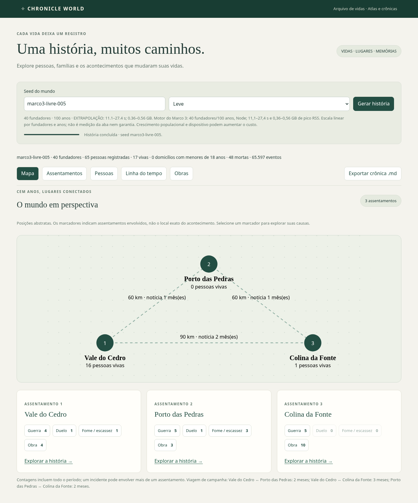
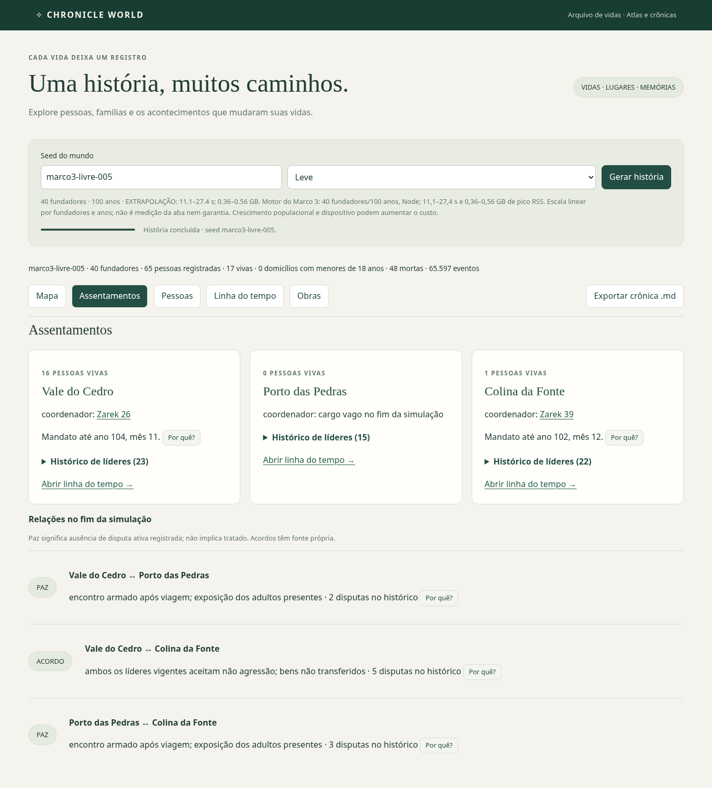
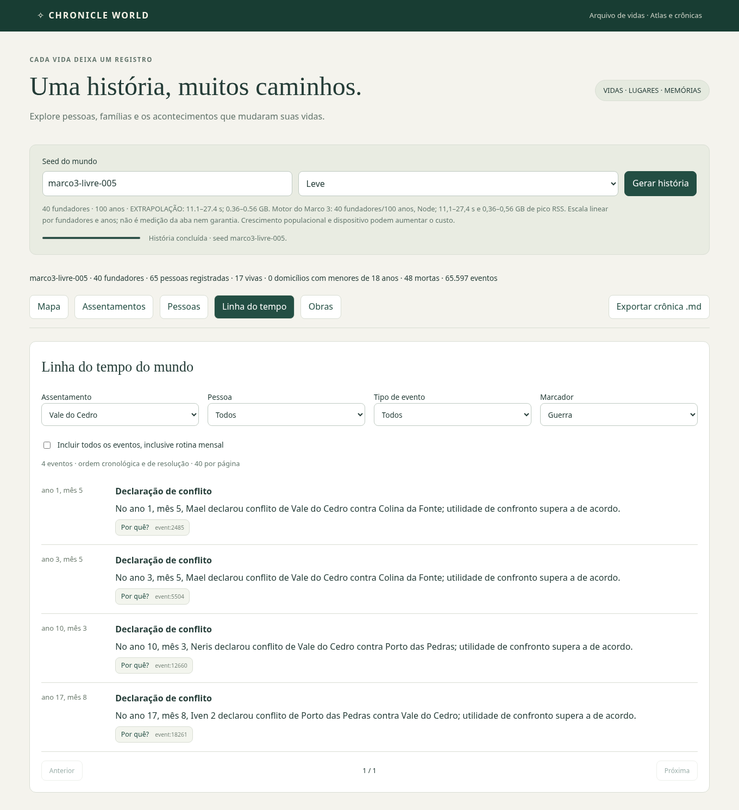
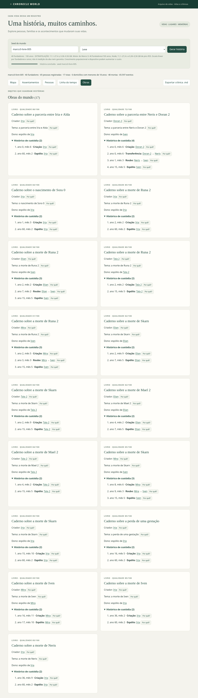

# Interface do mundo — Marco 5 antecipado

Entregue sobre o motor do Marco 3, sem alteração de regras ou arquivos do motor.

- **Mapa:** três assentamentos, conexões de 60/60/90 km e duração de viagem; marcadores de guerra, duelo, fome/escassez e obras abrem a cronologia correspondente. Posições abstratas e associações por residência histórica/participantes, sem inventar localização física.
- **Assentamentos:** população viva, cargo/líder vigente, histórico dos mandatos e relações atuais. Paz indica ausência de disputa ativa; não inventa tratado. Guerras ativas prevalecem sobre acordos antigos.
- **Cronologia:** filtros combináveis de assentamento, pessoa, tipo e marcador; paginação e “Por quê?” em cada registro. Rotina opcional; escolher um tipo específico permite consultá-lo mesmo sendo rotina.
- **Obras:** criador, tema conhecido, qualidade, dono/espólio e custódia cronológica, incluindo roubos. Criação, tema e transferências têm causas consultáveis.
- **Markdown:** botões para mundo inteiro e pessoa. A crônica mundial inclui os destaques de todas as pessoas/assentamentos, sem restringir pelos filtros da tela; omite rotina mensal e preserva IDs causais. A pessoal reutiliza a biografia cronológica e suas fontes.
- **Perfis:** Leve/Padrão/Épico = 40/70/100 fundadores, todos com 100 anos. Só muda a escala. Estimativas explicitamente extrapoladas de medições anteriores do motor em Node (11,1–27,4 s; 0,36–0,56 GB RSS para 40 fundadores), por multiplicador linear. Não são medição de memória da aba nem promessa para outro dispositivo. Padrão e Épico ainda não foram validados em execução nesta etapa.

**Validação:** 37 testes unitários (28 existentes + 9 novos) e build. Três seeds livres (`marco3-livre-001`, `005`, `008`) executadas pelo Worker real em Chromium, perfil Leve: **13,0 / 12,1 / 13,7 s** do clique até a interface pronta, incluindo transferência e projeção dos dados. Sem erros JavaScript. Verificados mapa, relações, filtros combinados, causalidade, roubos, downloads mundial/pessoal, seleção de perfil e ausência de transbordamento em 390 px. Não houve lote adicional de seeds. Memória da aba não foi medida nesta rodada. Uma execução do teste de download foi interrompida durante atualização dos arquivos; a repetição estabilizada passou nas três seeds.

[Dados dos testes](MARCO5-UI-VALIDACAO.json). Capturas finais usam o mesmo arquivo da seed `005`, com perfil Leve; também foi verificado o clique do marcador após o ajuste de contraste. Para repetir: `npx vitest run src/ui/v2/model.test.ts src/ui/v2/world-model.test.ts`; `npm run build`; servidor Vite em 5174 e `CHRONICLE_PLAYWRIGHT_MODULE=/caminho/playwright/index.mjs node scripts/check-m5-ui.mjs` (Chromium em `/usr/bin/chromium`).

## Capturas

